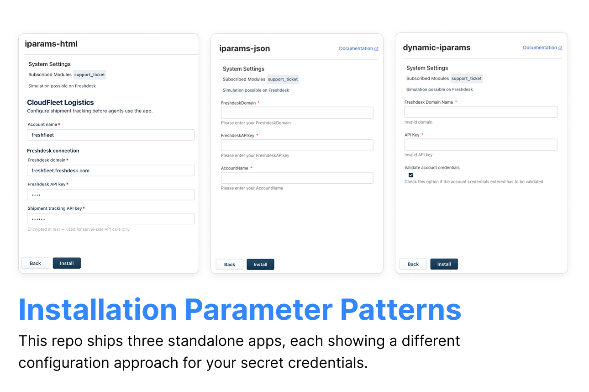

<p align="center">
  
</p>

# Configuration Page Samples — CloudFleet Logistics

A Freshworks Platform 3.0 sample collection demonstrating three **installation parameter (iparams)** patterns — static JSON, dynamic JavaScript, and custom HTML — so admins configure apps before agents use them.

## Description

CloudFleet Logistics connects shipment tracking APIs to Freshdesk tickets and CRM deals. Admins must capture domain, API keys, and routing rules on the installation page without exposing secrets or allowing mistyped domains. This repo ships three standalone apps, each showing a different configuration approach.

### Core Functionality

1. **Static iparams (`iparams-json`)** — module-scoped fields, secure API keys, dropdowns via `config/iparams.json`.
2. **Dynamic validation (`dynamic-iparams`)** — change events, regex hints, live credential check via `invokeTemplate`.
3. **Custom HTML page (`iparams-html`)** — branded install UX with `getConfigs` / `postConfigs` and secure credential handling.

## User Interfaces

Each sub-app is a standalone FDK project. Run `fdk validate` and `fdk run` from its folder.


| App         | Path               | Pattern                    | When to use                                          |
| ----------- | ------------------ | -------------------------- | ---------------------------------------------------- |
| Static JSON | `iparams-json/`    | `config/iparams.json`      | Simple fields, dropdowns, secure text                |
| Dynamic JS  | `dynamic-iparams/` | `config/assets/iparams.js` | Live validation, change events, API check on install |
| Custom HTML | `iparams-html/`    | `config/iparams.html`      | Full custom layout, branding, complex wizards        |


## Platform 3.0 Features Used

### 1. Static Installation Parameters

`iparams-json/config/iparams.json` defines text, dropdown, and secure fields scoped to modules:

```json
{
  "FreshdeskAPIkey": {
    "type": "text",
    "secure": true,
    "modules": ["support_ticket"]
  }
}
```

### 2. Dynamic Installation Page Events

`dynamic-iparams/config/assets/iparams.js` registers change handlers:

```javascript
client.events.on('domainChange', function () {
  // regex validation + utils.set hint
});
```

Optional credential validation calls `client.request.invokeTemplate('validateAPI', { context: { domain, apiKey } })`.

### 3. Custom HTML — getConfigs / postConfigs

`iparams-html/config/iparams.html` renders a Crayons form. `config/assets/iparams.js` implements:

- `getConfigs` — populate Edit Settings
- `postConfigs` — save with `__meta.secure` and `__meta.modules`
- `validate` — client-side checks before Install

## Project Structure

```
configuration-page-samples/
├── iparams-json/           # Static iparams.json
├── dynamic-iparams/        # iparams.js + requests.json
├── iparams-html/           # Custom installation page
├── usecase.md
└── README.md
```

## Prerequisites

- [Freshworks CLI (FDK)](https://developers.freshworks.com/docs/app-sdk/v3.0/support_ticket/basic-dev-tools/freshworks-cli/) v10.1.2 or later
- Node.js v24.x
- Freshdesk and/or Freshworks CRM trial accounts (depending on sub-app)

Enable global apps before local development:

```bash
fdk config set global_apps.enabled true
```

## Local Development

1. Clone the repository:
  ```bash
   git clone <repo-url>
   cd configuration-page-samples
  ```
2. Pick a sub-app and run from its folder:
  **Static JSON:**
   **Dynamic validation:**
   **Custom HTML:**
3. Install from **Admin → Apps** and complete the configuration page for each pattern.

## Key Learnings

1. **Module-scoped fields** — use `"modules": ["support_ticket"]` so Freshdesk-only fields do not appear on CRM installs.
2. **Secure parameters** — mark API keys with `"secure": true` (JSON) or `__meta.secure` (HTML) so values are encrypted at rest.
3. **Validate before save** — dynamic and custom pages can call Request Templates during install to confirm credentials work.

## Resources

- [Installation settings page](https://developers.freshworks.com/docs/app-sdk/v3.0/common/app-settings/installation-settings-page/)
- [Request methods](https://developers.freshworks.com/docs/app-sdk/v3.0/support_ticket/advanced-interfaces/request-method/)

